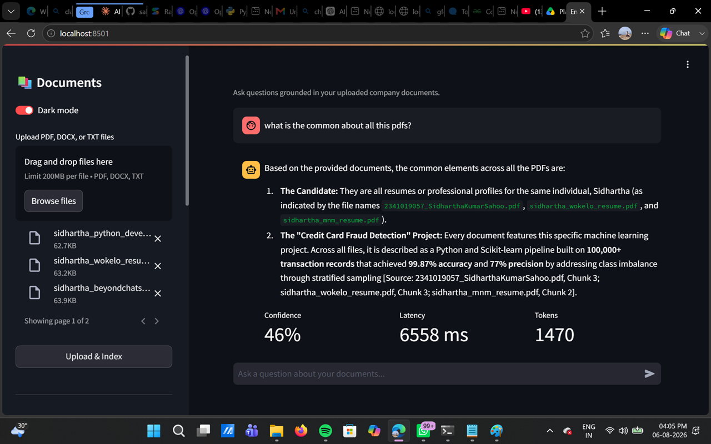

# Enterprise AI Knowledge Assistant

A production-style Retrieval-Augmented Generation (RAG) system that lets employees upload company documents (PDF, DOCX, TXT) and ask grounded, cited questions against them — instead of a generic chatbot that hallucinates answers.

Built as a portfolio project demonstrating enterprise RAG architecture: document ingestion pipelines, vector search, grounded generation, conversation memory, and observability (token usage, latency, confidence scoring).

\---

## Why this project exists

Most "AI chatbot" portfolio projects are a thin wrapper around a single LLM call. This project instead demonstrates the actual engineering that enterprise RAG systems require:

* A real ingestion pipeline (load → chunk → embed → store) instead of stuffing a whole document into a prompt
* Grounded generation with an explicit refusal path when the answer isn't in the documents (no hallucination)
* Multiple retrieval strategies (similarity / MMR / hybrid) and metadata filtering by document
* Query rewriting so follow-up questions in a conversation resolve correctly
* Persisted conversation memory, response caching, and per-query token/cost tracking
* A clean service-oriented backend (FastAPI) decoupled from a Streamlit UI, containerized with Docker

\---

## Architecture

```
                         ┌─────────────────────┐
                         │   Streamlit UI       │
                         │  (chat, upload,       │
                         │   sources, metrics)   │
                         └──────────┬───────────┘
                                    │ REST (JSON / streaming)
                                    ▼
                         ┌─────────────────────┐
                         │     FastAPI          │
                         │  routers/documents    │
                         │  routers/query         │
                         └──────────┬───────────┘
                                    │
                 ┌──────────────────┼───────────────────┐
                 ▼                                       ▼
     ┌─────────────────────┐                 ┌─────────────────────┐
     │  DocumentService      │                 │   RAGService          │
     │  - save upload         │                 │  - query rewriting     │
     │  - metadata (SQLite)   │                 │  - retrieval            │
     │  - delete/reindex      │                 │  - grounded generation │
     └──────────┬───────────┘                 │  - confidence scoring  │
                │                                │  - caching / tokens    │
                ▼                                └──────────┬───────────┘
     ┌─────────────────────┐                                │
     │  EmbeddingService      │◄───────────────────────────┘
     │  Loader → Splitter      │
     │  → Google Gemini Embeddings    │
     │  → ChromaDB              │
     └─────────────────────┘
```

### LangChain ingestion pipeline

```
Document Loader (PyPDFLoader / Docx2txtLoader / TextLoader)
        │
        ▼
RecursiveCharacterTextSplitter (chunk\_size=1000, overlap=200)
        │
        ▼
GoogleGenerativeAIEmbeddings (models/embedding-001)
        │
        ▼
ChromaDB (persisted collection, metadata: document\_id, filename, chunk\_index)
```

### Query pipeline

```
User question
        │
        ▼
Query rewriting (resolves follow-ups using conversation history)
        │
        ▼
Retriever (similarity / MMR / hybrid, optional per-document metadata filter)
        │
        ▼
Prompt template (context-only, anti-hallucination system prompt)
        │
        ▼
LLM (GPT-4o) ──► Output parser ──► grounded answer + sources + confidence
```

\---

## Folder structure

```
enterprise-ai-assistant/
├── backend/
│   ├── main.py                 # FastAPI app, CORS, exception handlers
│   ├── config/
│   │   └── settings.py         # Pydantic settings, env-driven, no secrets in code
│   ├── models/
│   │   └── schemas.py          # Pydantic request/response models
│   ├── database/
│   │   └── db.py               # SQLAlchemy models + session (SQLite)
│   ├── services/
│   │   ├── document\_service.py # upload/metadata/delete/reindex orchestration
│   │   ├── embedding\_service.py# LangChain ingestion + Chroma retriever
│   │   └── rag\_service.py      # query rewriting, retrieval, generation, caching
│   ├── routers/
│   │   ├── documents.py        # /upload /documents /document/{id} /reindex
│   │   └── query.py            # /query /query/stream /history
│   └── utils/
│       ├── logger.py           # centralized structured logging
│       ├── cache.py            # in-memory TTL cache
│       └── exceptions.py       # typed exception hierarchy
├── frontend/
│   └── app.py                  # Streamlit dashboard
├── docker/
│   ├── Dockerfile.backend
│   └── Dockerfile.frontend
├── tests/
│   └── test\_basic.py
├── docs/
│   └── screenshots/            # (placeholder — add UI screenshots here)
├── docker-compose.yml
├── requirements.txt
├── .env.example
└── README.md
```

\---

## Features

|Category|Feature|
|-|-|
|Ingestion|Multi-file upload (PDF, DOCX, TXT), automatic chunking + embedding|
|Retrieval|Similarity, MMR (diversity-aware), hybrid, per-document metadata filtering|
|Generation|Context-only grounded answers, explicit "not found" fallback, source citations|
|Conversation|Persisted multi-turn memory, query rewriting for follow-ups|
|Observability|Confidence score, latency, token usage + estimated cost per query|
|Reliability|Typed exceptions, structured logging, response caching|
|Document ops|List, delete, re-index|
|UI|Streamlit chat with sidebar document manager, dark mode, source/confidence panels|
|Streaming|Token-by-token streaming endpoint (`/query/stream`)|

\---

## API endpoints

|Method|Endpoint|Description|
|-|-|-|
|`GET`|`/health`|Liveness check|
|`POST`|`/api/upload`|Upload one or more documents (multipart)|
|`GET`|`/api/documents`|List all documents + status|
|`DELETE`|`/api/document/{id}`|Delete a document and its vectors|
|`POST`|`/api/reindex/{id}`|Re-run ingestion for a document|
|`POST`|`/api/query`|Ask a question, get a grounded JSON answer|
|`POST`|`/api/query/stream`|Same as above, streamed token-by-token|
|`GET`|`/api/history/{conversation\_id}`|Fetch conversation turns|

Interactive Swagger docs are auto-generated by FastAPI at `/docs` once the backend is running.

\---

## Installation (local, no Docker)

```bash
git clone <your-repo-url>
cd enterprise-ai-assistant

python -m venv .venv
source .venv/bin/activate          # Windows: .venv\\Scripts\\activate

pip install -r requirements.txt

cp .env.example .env
# edit .env and set GOOGLE\_API\_KEY

# Terminal 1 — backend
uvicorn backend.main:app --reload --port 8000

# Terminal 2 — frontend
streamlit run frontend/app.py
```

Visit `http://localhost:8501` for the UI and `http://localhost:8000/docs` for the API.

\---

## Running with Docker

```bash
cp .env.example .env
# edit .env and set GOOGLE\_API\_KEY

docker-compose up --build
```

* Backend: `http://localhost:8000`
* Frontend: `http://localhost:8501`

\---

## Running tests

```bash
pytest tests/ -v
```

\---

## Deployment

### Render / Railway

1. Push this repo to GitHub.
2. Create two services from the same repo: one using `docker/Dockerfile.backend` (web service, port 8000), one using `docker/Dockerfile.frontend` (port 8501).
3. Set `GOOGLE\_API\_KEY` and other `.env.example` values as environment variables in the platform dashboard — never commit `.env`.
4. Set the frontend's `API\_BASE\_URL` env var to the deployed backend's public URL + `/api`.
5. Attach a persistent volume/disk for `/app/data` on the backend service so ChromaDB and SQLite survive restarts.

### Azure (App Service / Container Apps)

1. Build and push both images to Azure Container Registry:

```bash
   az acr build --registry <registry> --image enterprise-ai-backend -f docker/Dockerfile.backend .
   az acr build --registry <registry> --image enterprise-ai-frontend -f docker/Dockerfile.frontend .
   ```

2. Deploy each as a separate Container App, mounting an Azure File Share to `/app/data` on the backend for persistence.
3. Configure app settings (env vars) for `GOOGLE\_API\_KEY`, etc. via the Azure Portal or `az containerapp update --set-env-vars`.

### AWS EC2

1. Provision an EC2 instance (Ubuntu, t3.medium+ recommended for Chroma), install Docker + Docker Compose.
2. `git clone` the repo, add `.env`, then `docker-compose up -d --build`.
3. Open ports 8000 and 8501 in the security group (or put both behind an Nginx reverse proxy on 80/443).
4. Mount an EBS volume to the host path backing `./data` for persistence across instance restarts.

\---

## Prompt engineering approach

The system prompt explicitly instructs the model to:

1. Only use the retrieved context — never outside knowledge.
2. Never fabricate facts, numbers, or policy details.
3. Return a fixed fallback string (`"I couldn't find relevant information in the uploaded documents."`) when the context doesn't contain the answer, so the UI can detect and surface "no answer found" states distinctly from real answers.

Confidence scoring is derived from retriever similarity scores rather than asking the LLM to self-report confidence, since LLM self-reported confidence is known to be unreliable.

\---

## Known limitations \& future improvements

* **Hybrid retrieval** is currently a widened-similarity approximation; a true hybrid (BM25 keyword search + vector search with reciprocal rank fusion) would improve recall on exact-match queries like policy codes or names.
* **Token counting** uses a character-based heuristic instead of `tiktoken`, to avoid an extra heavy dependency for a demo project — swap in `tiktoken` for exact counts in production.
* **Auth** is not implemented; a real enterprise deployment would add SSO/JWT auth and per-user document access control.
* **Multi-tenancy**: the current Chroma collection is shared across all documents; a production system would namespace collections per team/org.
* **Evaluation**: no automated RAG quality eval (e.g., RAGAS) is wired in yet — a natural next step to quantify answer faithfulness and retrieval precision over time.


## Screenshots



Grounded answer with cited sources, confidence score, latency, and token usage.

## Tech stack

**Backend:** Python, FastAPI, SQLAlchemy, SQLite
**AI/RAG:** LangChain, Google Gemini 1.5 Flash, Google Gemini Embeddings, ChromaDB
**Frontend:** Streamlit
**Infra:** Docker, Docker Compose

> **Note on model choice:** this project uses Google Gemini instead of OpenAI because Gemini offers a genuinely free API tier (no billing method required to start), making it easier to run and demo this project without cost. Swapping to OpenAI, Anthropic, or any other LangChain-supported provider is a small, isolated change confined to `backend/services/rag\_service.py` and `backend/services/embedding\_service.py`.

